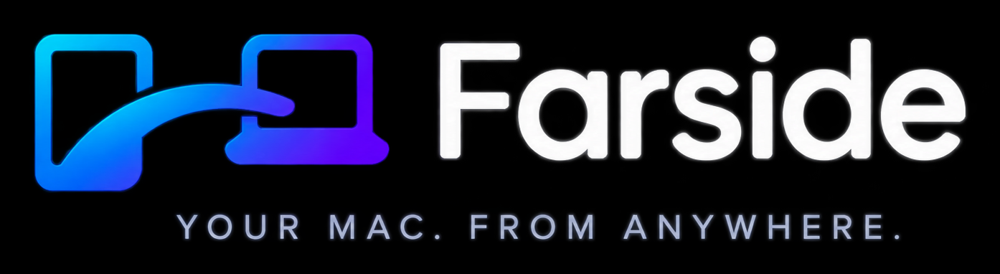

Farside lets an iPad see and control a Mac, on the same network or from anywhere. The plan,
with its decisions and build phases, is [Docs/plan.md](Docs/plan.md); the decision records are in
[Docs/adr](Docs/adr).

| Part | Where |
| --- | --- |
| iPad app | `Apps/Client` |
| Mac host (menu bar app) | `Apps/Host` |
| Shared Swift packages | `Packages/` |
| Backend (Laravel, Reverb) | `Server/api` |
| Deployment | `Server/deploy`, see its README |

Common commands: `make generate` (Xcode project from `project.yml`), `make test` (package tests),
`make server-test` (backend tests), `make run-host`, `make install-client IPAD=<device id>`,
`make server-up` (local backend). `Config/Local.xcconfig`, made from
`Config/Local.xcconfig.example`, holds your team and backend address and is not committed.
